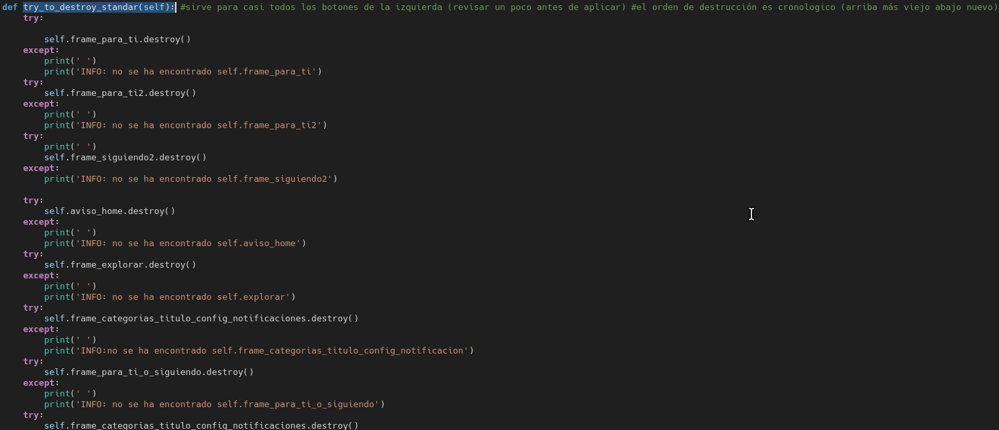
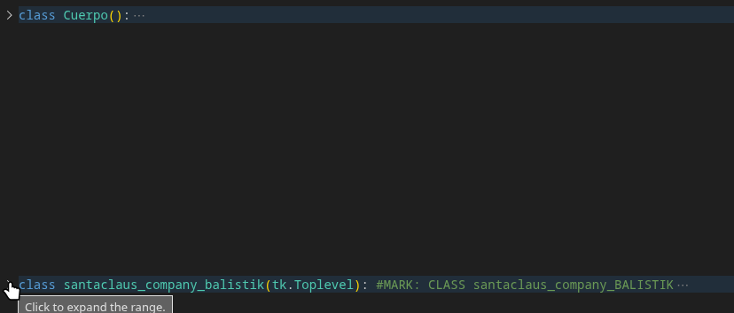
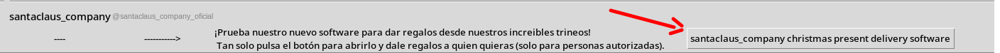
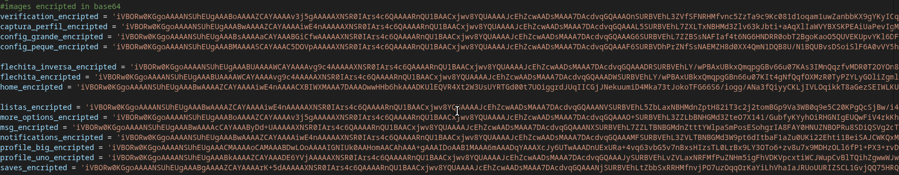
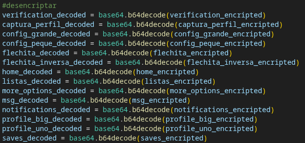
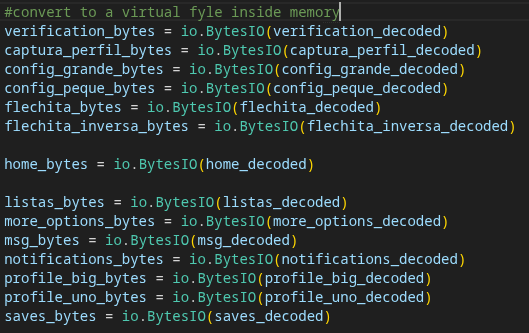
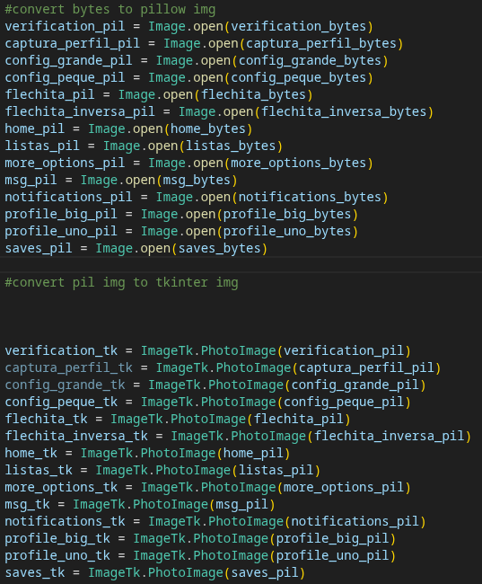

# what is this?

This project is a simulation of the Twitter interface and functionality for educational purposes.
This project is not affiliated with or endorsed by X Corp.

The project started in 2023 when I was 14 years old, with the purpose of learning tkinter and python.
The project stopped development in 2025. Anyways I will check pull requests and accept them if they add the missing features or fix the existing bugs.
# features
posts. Write what you want and click the arrow to post it.
notifications.

following users. When you follow a user or users you can go to Inicio and Siguiendo to se the posts of the users you are following.

messages. You can message a bot.

a calculator and a unit converter. Click "más opciones" to try it.

Accounts. click the "Usuario" button to create an account or log in.

# code features
### try_to_destroy_standar()
as the project grew and I had more and more frames and tkinter widgets I had to come up with a way to clean the screen before rendering the next thing.
try_to_destroy_standar() is what I came up with for this purpose.

### classes
At that time I didn't know much about classes and how to use them or how to write them. That is why only very late in the project, once I had studied python classes I created one extra class for the code of the santaclaus christmas present delivery

### 100% monolithic code base! 
Everything needed to run the program is inside the .py file. The only thing you need to install is the pillow libary with pip. Even the images are inside of the code base!

the images are encrypted in base 64:

then the images get decrypted:

then they get transformed into a virtual file inside of memory:

then we open the virtual image files with pillow so we can use them to create tkinter image variables that we can use in the code.

One of the questions I had when I was building this project was "how much can the code base grow while keeping everything in the same Python file and still having the program to work properly?". Well, the answer for now is **2613 lines of code**.

